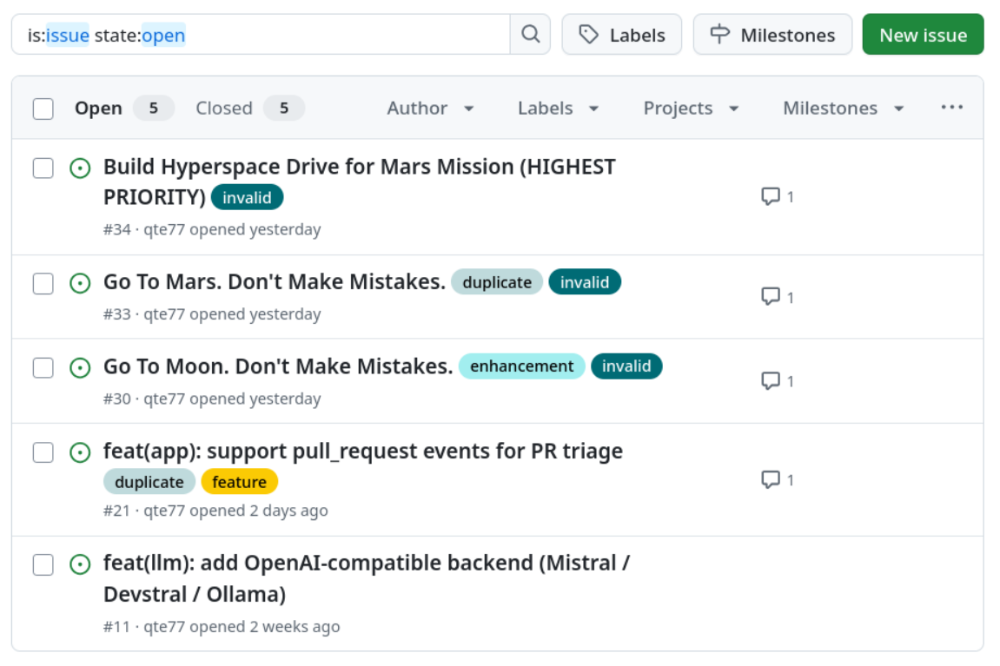

# gha-issue-triage

AI-powered issue triage GitHub Action. Detects duplicates, scores relevance,
analyzes feasibility, auto-labels, and posts a sticky summary comment with the
analysis (edited in place on re-runs).

[](LICENSE)
[](CHANGELOG.md)
[](https://github.com/qte77/gha-issue-triage/actions/workflows/codeql.yml)
[](https://www.codefactor.io/repository/github/qte77/gha-issue-triage)
[](https://github.com/qte77/gha-issue-triage/actions/workflows/test.yml)
[](https://github.com/qte77/gha-issue-triage/actions/workflows/ruff.yml)
[](https://github.com/qte77/gha-issue-triage/actions/workflows/dependabot/dependabot-updates)

## What

1. **Duplicate Detection** — Fuzzy matches new issues against existing ones using `difflib.SequenceMatcher`
2. **Relevance Scoring** — LLM-based scoring against repo scope (README.md, CLAUDE.md)
3. **Feasibility Analysis** — `feasibility` (`yes` / `no`: can this be built at all?) plus `complexity` (`low` / `medium` / `high`); `low` drives `good first issue`
4. **Auto-Labeling** — Applies labels (aligned with GitHub's default label set): `bug`, `documentation`, `duplicate`, `enhancement`, `feature`, `good first issue`, `invalid`, `needs discussion`
5. **Sticky Summary Comment** — One bot comment with the analysis, edited in place on re-runs. On auth/API failures the same slot carries a `### Triage failure` comment with the concrete fix

<details>
<summary>Screenshot — triaged issues in this repo</summary>

<picture>
  <source media="(prefers-color-scheme: dark)" srcset="assets/images/screenshot_issues_dark.png">
  
</picture>

</details>

## How

```yaml
name: Issue Triage
on:
  issues:
    types: [opened, edited]

jobs:
  triage:
    runs-on: ubuntu-latest
    permissions:
      issues: write
      contents: read
    steps:
      - uses: qte77/gha-issue-triage@1bf71f215a70a9b19f228e1c190aaf578baa6a59  # v0.4.0
        with:
          GH_TOKEN: ${{ secrets.GITHUB_TOKEN }}
          llm-api-key: ${{ secrets.CF_WORKERS_AI_TOKEN }}
          MODEL: "@cf/meta/llama-3.3-70b-instruct-fp8-fast"
          api_base: ${{ secrets.LLM_BASE_URL }}  # https://api.cloudflare.com/client/v4/accounts/<id>/ai/v1
```

> **GitHub Models was retired 2026-07-30**, so the default `MODEL` no longer works on its own — set
> `api_base` + `llm-api-key` (any OpenAI-compatible backend) or `ANTHROPIC_API_KEY`.

All inputs, other backends (Mistral, Cerebras, Groq, Ollama, ...) and troubleshooting: see
[`docs/integrations.md`](docs/integrations.md).

## Why

Triage usually means a maintainer reading every new issue before anything else happens. This
action does that first pass automatically on every opened or edited issue: duplicate check,
relevance, feasibility. It leaves labels and one sticky comment, using whichever LLM backend you
point it at.

## Refs

- [`docs/integrations.md`](docs/integrations.md) — inputs, backends, caller examples, troubleshooting
- [`docs/architecture.md`](docs/architecture.md) — boundary failure policies
- [`action.yaml`](action.yaml) — input definitions
- [`.github/workflows/self-triage.yml`](.github/workflows/self-triage.yml) — this repo dogfooding the action
- [`CHANGELOG.md`](CHANGELOG.md)

## License

Apache-2.0 — see [LICENSE](LICENSE).
